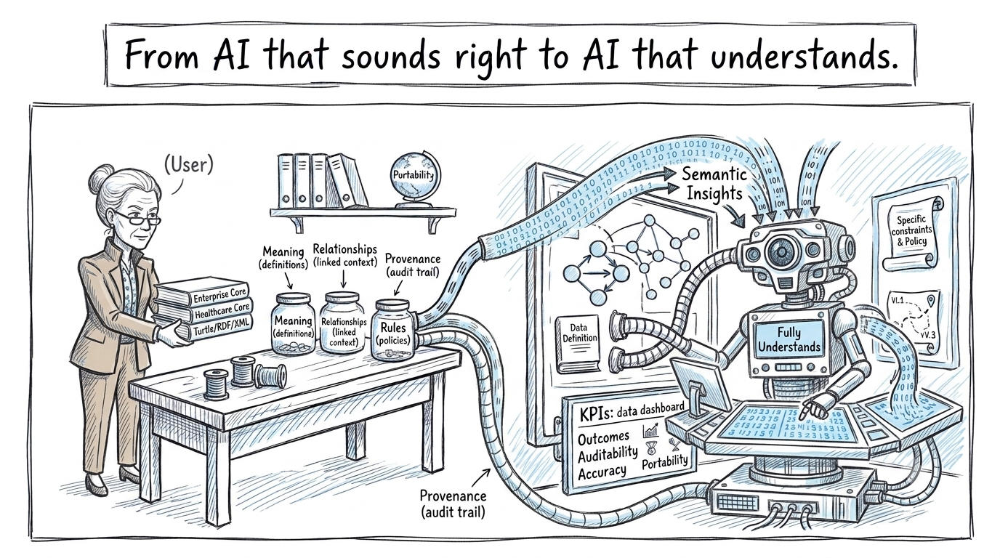
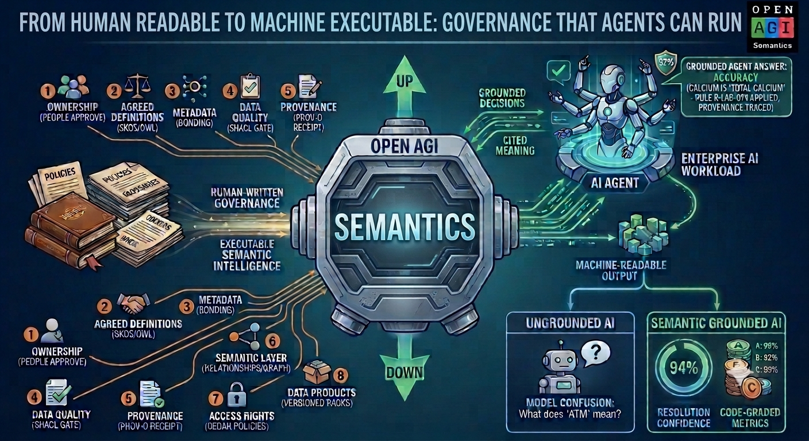
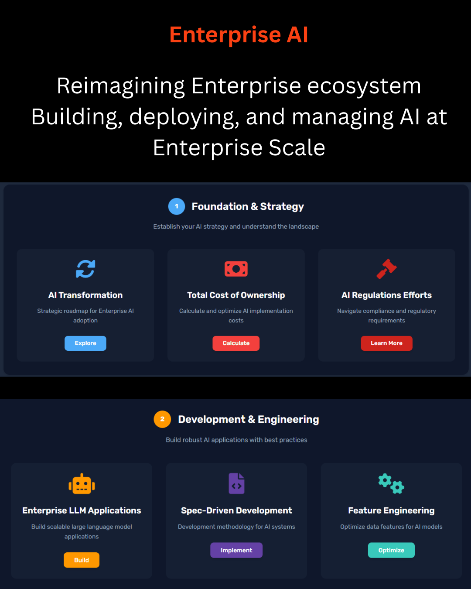
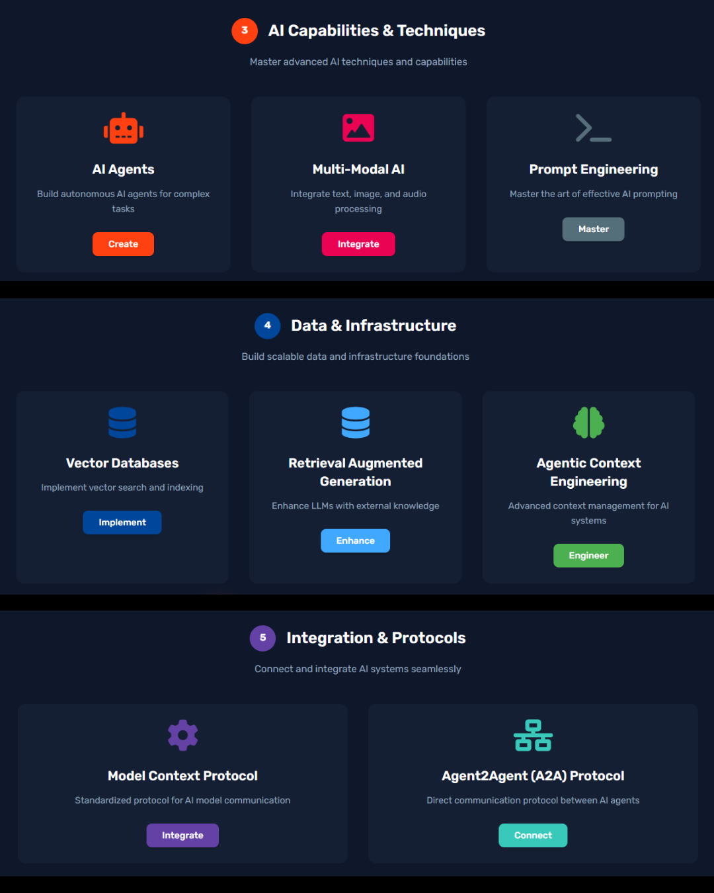
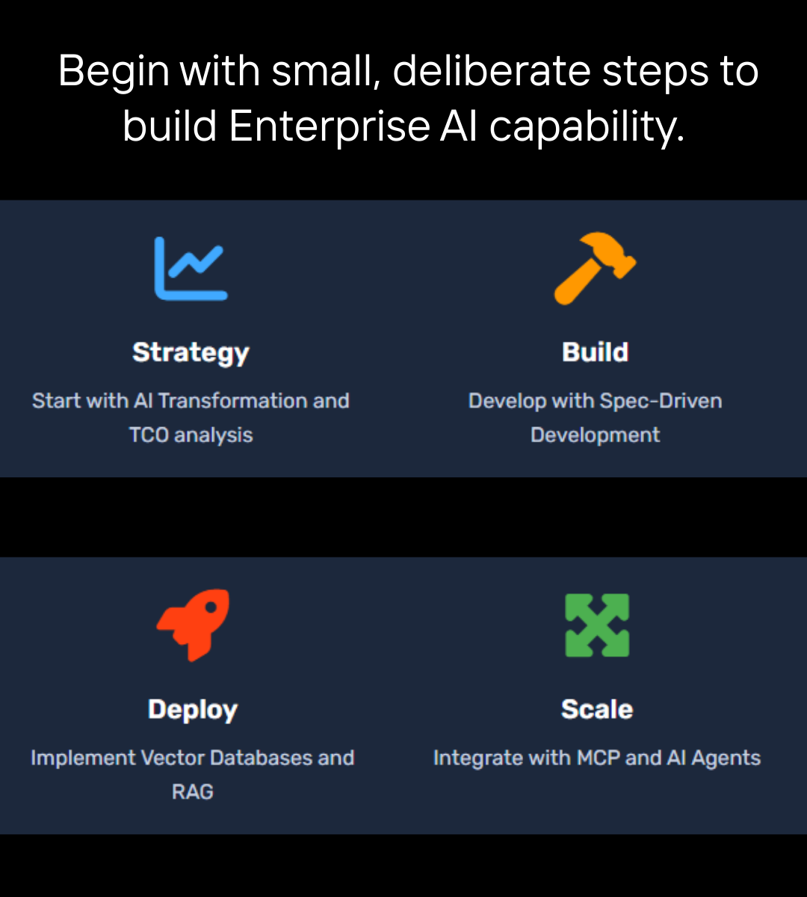

<div align="center">

# Open AGI Stack Semantics

### Intelligence into the products

**The Semantic Intelligence layer for enterprise AI**

*From AI that sounds right to AI that understands.*
*Give your AI the context your people already carry.*


</div>

[](https://www.openagistack.com/articles/open-agi-stack-semantic-article/)

---

## Overview

Enterprise AI stalls on **meaning**, not model quality. **Open AGI Stack Semantics** turns human-written policies, glossaries, and schemas into executable semantic intelligence that AI agents can **verify, cite, and run**.

### The Four-Plane Operating Architecture for Enterprise AI

[](https://www.openagistack.com/images/products/semantic-intelligence-semantics.png)

---

## The Four-Plane Architecture

| Plane | Character | Role |
|-------|-----------|------|
| **Meaning Plane** | Slow, Governed | Authoritative repository of business meaning |
| **Facts Plane** | Fast, Validated | High-throughput, gate-checked operational data |
| **Policy Plane** | Security & Audit | Access control, regulatory boundaries, immutable logging |
| **Agent Plane** | Grounding & Execution | Runtime interface where agents converse and act |

```text
┌──────────────────────────────────────────────────────────────┐
│  AGENT PLANE      Grounding & Execution                      │
│  resolve concepts · broker context · validate plans          │
├──────────────────────────────────────────────────────────────┤
│  POLICY PLANE     Security & Audit                           │
│  RBAC / ABAC · semantic labels · action log · PROV-O         │
├──────────────────────────────────────────────────────────────┤
│  FACTS PLANE      Fast, Validated                            │
│  map & ingest · ABox store · SHACL gates · audit stamps      │
├──────────────────────────────────────────────────────────────┤
│  MEANING PLANE    Slow, Governed                             │
│  author · validate · evaluate · version · pin                │
└──────────────────────────────────────────────────────────────┘
        ▲                                                │
        └──────── Continuous Feedback Backlog ◄──────────┘
        (failures and unmapped queries return as draft change sets)
```

---

## Meaning Plane
**Slow, Governed**

The authoritative repository of business meaning. Curated by domain archivists and stewards, where concepts are authored, validated, evaluated, and versioned before pinning.

**Key Services**

- Official Archivist & Stewardship
- Authoring & Change Service
- Registry & Release Service
- Reasoning (TBox) & Validation
- Evaluation & Consistency Service

---

## Facts Plane
**Fast, Validated**

High-throughput operational ingestion pipeline. Raw enterprise data is mapped into instances (ABox), materialized, and gate-checked with SHACL schemas before receiving audit stamps.

**Key Services**

- Mapping & Ingestion Service
- ABox Instance Store (Asserted & Inferred)
- Quarantine & Provenance Isolation
- Materializer Engine
- SHACL Validator & Audit Stamping

---

## Policy Plane
**Security & Audit**

Fine-grained security, regulatory boundaries, and immutable execution logging. Ensures agents only touch authorized slices of data and generates tamper-proof PROV-O audit receipts.

**Key Services**

- Policy & Access Service (RBAC / ABAC)
- Semantic Labels & Security Bundles
- Action Layer & Real-time Action Log
- Audit & PROV-O Receipt Service

---

## Agent Plane
**Grounding & Execution**

The runtime interface where enterprise AI agents converse and execute. Brokers context, resolves concepts, validates plans, and closes the loop by feeding failures back into draft change sets.

**Key Services**

- Resolution Service (Lexical + Vector)
- Context Broker & Token Budgeter
- Grounding (Evidence & Plan Checks)
- API Gateway, SPARQL & MCP Endpoints
- Continuous Feedback Backlog

---

## Semantics Design Principles

### Slow, Governed Meaning
Humans define and approve vocabulary once; machines never guess semantic truth.

### Fast, Validated Facts
Real-time data ingestion enforced by deterministic SHACL constraints and validation gates.

### Security & Audit
Every read, write, and inference is bounded by policy and leaves an immutable PROV-O receipt.

### Continuous Feedback
Execution failures and unmapped queries feed back to curators as draft change proposals.

### Traceable & Versioned
Every concept, rule, and fact pin is versioned. Models can change, but meaning never drifts.

---

## Related

- **[SenseGraph](./README.md)**: the 6-stage query understanding pipeline that resolves user queries into grounded concepts and scoped retrieval.
- Product page: [openagistack.com](https://go.openagistack.com)

---

<div align="center">

------------------------------------------------------------------------------------------------------------------------------------
[](https://www.openagistack.com/articles/open-agi-stack-semantic-article/)
Read [https://www.openagistack.com/articles/open-agi-stack-semantic-article/](https://www.openagistack.com/articles/open-agi-stack-semantic-article/)
------------------------------------------------------------------------------------------------------------------------------------
[](https://go.openagi.codes)
------------------------------------------------------------------------------------------------------------------------------------
[](https://go.openagi.codes)
------------------------------------------------------------------------------------------------------------------------------------
[](https://go.openagi.codes)
------------------------------------------------------------------------------------------------------------------------------------


**Open AGI Stack Semantics** · Semantic Intelligence for enterprise AI

</div>
